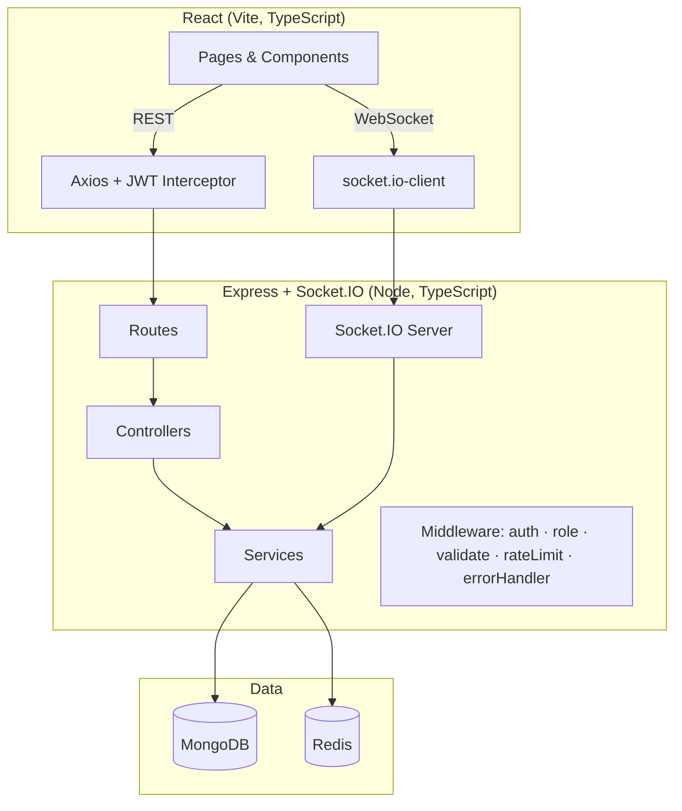

# DocTrack – Document Application & Status Tracking Platform

A full-stack web platform where **customers** submit document service applications (passport, driving licence, Aadhaar update, etc.) and **admins** process them through a defined status workflow. Status changes push to customers **in real time** via Socket.IO.

> **Author:** Sanjay Sharma
> **Purpose:** Portfolio project for the Full-Stack Development Internship (Nish E-Service OPC Private Limited)

---

## Tech Stack

| Layer | Technology |
|-------|-----------|
| Language | TypeScript (strict mode) |
| Backend | Node.js, Express.js 5 |
| Database | MongoDB + Mongoose |
| Cache | Redis (ioredis) |
| Real-time | Socket.IO |
| Validation | Zod |
| Auth | JWT (jsonwebtoken) + bcrypt |
| Frontend | React 19 + Vite + TypeScript |
| Routing | React Router v7 |
| HTTP Client | Axios |
| Testing | Jest + Supertest |
| Hosting | Render/Railway · Vercel · MongoDB Atlas · Upstash Redis |

---

## Architecture



### Layered Backend

```
Routes → Controllers → Services → Models
              ↑
         Middleware (auth, role, validate, rateLimit, errorHandler)
```

- **Routes** handle HTTP verbs and paths
- **Controllers** parse requests and call services
- **Services** hold business logic (transitions, caching, socket emits)
- **Models** talk to MongoDB via Mongoose

---

## Repository Structure

```
doctrack/
├── server/
│   ├── src/
│   │   ├── config/          # env, db, redis connections
│   │   ├── models/          # User, Application, StatusHistory
│   │   ├── schemas/         # Zod validation schemas
│   │   ├── middleware/      # auth, requireRole, validate, rateLimiter, errorHandler
│   │   ├── services/        # authService, applicationService, cacheService
│   │   ├── controllers/     # auth, application, admin controllers
│   │   ├── routes/          # auth, application, admin routes
│   │   ├── sockets/         # Socket.IO setup, auth, rooms, presence
│   │   ├── utils/           # ApiError, response helpers
│   │   ├── scripts/         # seedAdmin.ts
│   │   ├── app.ts           # Express app (testable without server)
│   │   └── server.ts        # HTTP + Socket.IO bootstrap
│   ├── tests/               # Jest + Supertest tests
│   ├── .env.example
│   └── package.json
├── client/
│   ├── src/
│   │   ├── api/             # Axios instance, auth & application API calls
│   │   ├── context/         # AuthContext, SocketContext
│   │   ├── components/      # Navbar, ProtectedRoute, StatusBadge, Toast, Timeline, StatsCard
│   │   ├── pages/           # Login, Register, CustomerDashboard, NewApplication, ApplicationDetail, AdminDashboard
│   │   ├── types/           # Shared TypeScript types
│   │   ├── App.tsx
│   │   └── main.tsx
│   ├── .env.example
│   └── package.json
├── prd.md
├── trd.md
└── README.md
```

---

## Setup

### Prerequisites

- **Node.js** ≥ 18 LTS
- **MongoDB** (local, Docker, or Atlas)
- **Redis** (local, Docker, or Upstash)
- **Git**

### 1. Clone the repo

```bash
git clone https://github.com/YOUR_USERNAME/doctrack.git
cd doctrack
```

### 2. Server setup

```bash
cd server
cp .env.example .env     # Edit .env with your MongoDB URI, Redis URL, JWT_SECRET
npm install
npm run seed:admin        # Creates admin@doctrack.local / Admin@123
npm run dev               # Starts on http://localhost:5000
```

### 3. Client setup

```bash
cd client
cp .env.example .env     # Usually fine as-is for local dev
npm install
npm run dev              # Starts on http://localhost:5173
```

### 4. Run tests

```bash
cd server
npm test
```

---

## Environment Variables

### server/.env

| Variable | Description | Default |
|----------|-------------|---------|
| `NODE_ENV` | `development` / `production` / `test` | `development` |
| `PORT` | Server port | `5000` |
| `MONGODB_URI` | MongoDB connection string | `mongodb://localhost:27017/doctrack` |
| `REDIS_URL` | Redis connection string | `redis://localhost:6379` |
| `JWT_SECRET` | Secret for signing JWTs | *(required)* |
| `JWT_EXPIRES_IN` | Token lifespan | `7d` |
| `CLIENT_ORIGIN` | Allowed CORS origin | `http://localhost:5173` |

### client/.env

| Variable | Description | Default |
|----------|-------------|---------|
| `VITE_API_URL` | Backend API base URL | `http://localhost:5000/api` |
| `VITE_SOCKET_URL` | Socket.IO server URL | `http://localhost:5000` |

---

## API Endpoints

### Auth (`/api/auth`)

| Method | Endpoint | Access | Description |
|--------|----------|--------|-------------|
| POST | `/register` | Public | Register a customer account |
| POST | `/login` | Public | Login, returns JWT (rate-limited) |
| GET | `/me` | Authenticated | Current user profile |

### Applications (`/api/applications`)

| Method | Endpoint | Access | Description |
|--------|----------|--------|-------------|
| POST | `/` | Customer | Create an application |
| GET | `/mine` | Customer | List own applications (paginated) |
| GET | `/:id` | Owner or Admin | Application detail with status history |

### Admin (`/api/admin`)

| Method | Endpoint | Access | Description |
|--------|----------|--------|-------------|
| GET | `/applications` | Admin | List all (filters: status, type, search, page, limit) |
| PATCH | `/applications/:id/status` | Admin | Update status with optional note |
| GET | `/stats` | Admin | Count per status |

### Health

| Method | Endpoint | Description |
|--------|----------|-------------|
| GET | `/api/health` | Server, MongoDB, Redis status |

### Response Shape

```json
// Success
{ "success": true, "data": { ... }, "error": null }

// Error
{ "success": false, "data": null, "error": { "code": "VALIDATION_ERROR", "message": "...", "details": [] } }
```

---

## Socket.IO Events

| Event | Direction | Payload | Purpose |
|-------|-----------|---------|---------|
| `application:statusUpdated` | Server → customer room | `{ applicationId, status, note, updatedAt }` | Live status change notification |
| `application:created` | Server → `admins` room | `{ applicationId, type, title }` | Notify admins of new submissions |
| `presence:adminOnline` | Server → all clients | `{ online: boolean }` | Admin online/offline indicator |

**Connection:** Client sends JWT in `socket.handshake.auth.token`. Server verifies and joins the user to `user:<userId>`. Admins also join the `admins` room.

---

## Status Workflow

```
SUBMITTED    → UNDER_REVIEW | REJECTED
UNDER_REVIEW → DOCS_NEEDED  | COMPLETED | REJECTED
DOCS_NEEDED  → UNDER_REVIEW | REJECTED
COMPLETED    → (final)
REJECTED     → (final)
```

Invalid transitions are rejected with HTTP 400 (`INVALID_STATUS_TRANSITION`).

---

## Screenshots

> *Replace these placeholders with actual screenshots after deployment.*

| Screen | Screenshot |
|--------|-----------|
| Login Page | *[screenshot]* |
| Customer Dashboard | *[screenshot]* |
| New Application Form | *[screenshot]* |
| Application Detail & Timeline | *[screenshot]* |
| Admin Dashboard | *[screenshot]* |
| Live Status Update Toast | *[screenshot]* |

---

## Deployment

### 1. MongoDB Atlas

1. Create a free cluster at [mongodb.com/atlas](https://www.mongodb.com/atlas)
2. Create a database user and get the connection string
3. Add `0.0.0.0/0` to the IP allowlist (or your backend host's IP)

### 2. Upstash Redis

1. Create a free Redis database at [upstash.com](https://upstash.com)
2. Copy the Redis URL (TLS-enabled)

### 3. Backend on Render

1. Create a new **Web Service** at [render.com](https://render.com)
2. Connect your GitHub repo; set **Root Directory** to `server`
3. **Build Command:** `npm install && npm run build`
4. **Start Command:** `npm start`
5. Add all environment variables from `server/.env.example`
6. Set `CLIENT_ORIGIN` to your Vercel frontend URL

### 4. Frontend on Vercel

1. Import the repo at [vercel.com](https://vercel.com)
2. Set **Root Directory** to `client`
3. **Framework Preset:** Vite
4. Add environment variables:
   - `VITE_API_URL` = `https://your-backend.onrender.com/api`
   - `VITE_SOCKET_URL` = `https://your-backend.onrender.com`

### 5. Seed the admin

```bash
# In the Render shell, or locally pointing at the Atlas URI:
SEED_ADMIN_EMAIL=admin@doctrack.local SEED_ADMIN_PASSWORD=Admin@123 npx tsx src/scripts/seedAdmin.ts
```

### 6. Test end-to-end

Open the Vercel URL, register a customer, submit an application, then log in as admin in another tab and change the status. The customer tab should show a live toast.

---

## Bugs Found & Fixed / Future Improvements

| # | Description | Status |
|---|-------------|--------|
| 1 | | |
| 2 | | |
| 3 | | |

### Future Improvements

- Real document uploads (Cloudflare R2 / AWS S3)
- Email/SMS notifications on status change
- Audit log export (CSV/PDF)
- Staff role with limited permissions
- Multi-language UI
- PWA with push notifications

---

## License

MIT
